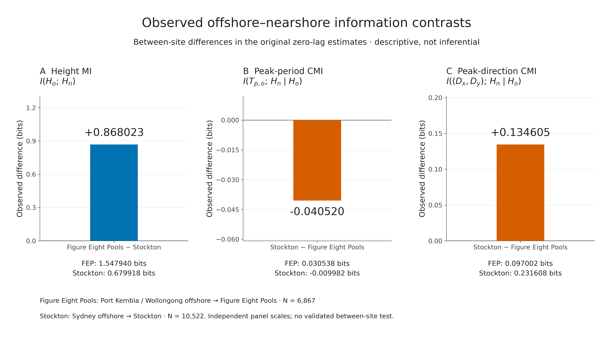
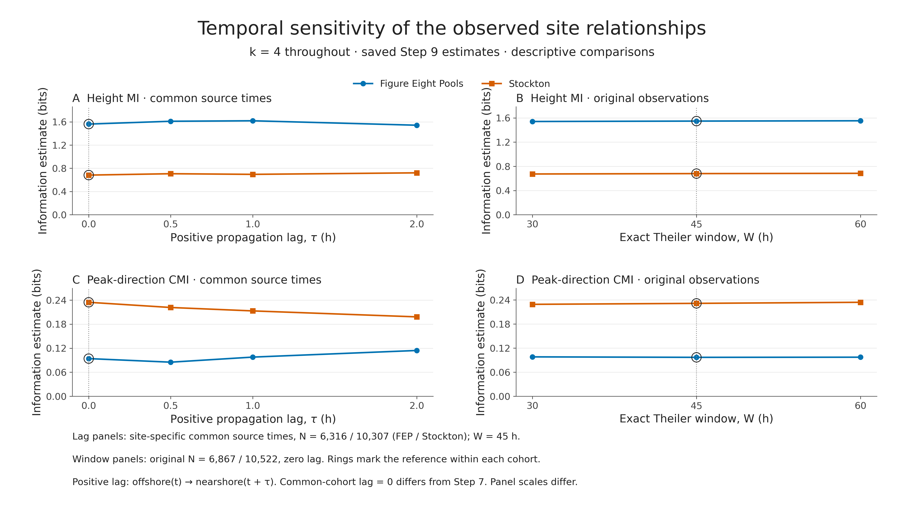
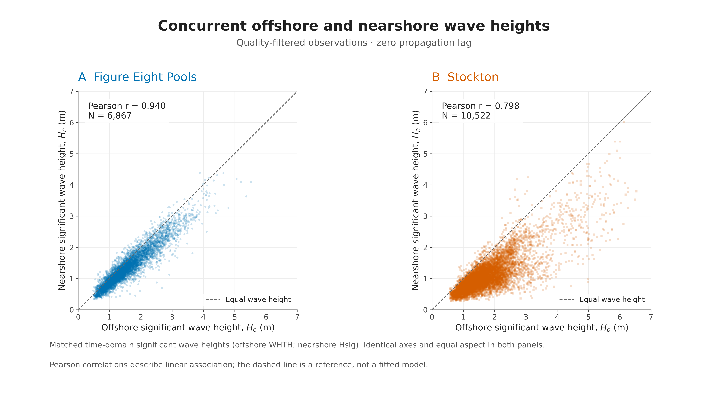

# Offshore–nearshore wave dependence across contrasting NSW coastal settings: an information-theoretic analysis

## Abstract

This study compares offshore–nearshore wave information relationships for Wollongong (Port Kembla)–Figure Eight Pools and Sydney–Stockton. Hourly offshore and half-hourly nearshore wave parameters yielded 6,867 and 10,522 complete, quality-filtered concurrent observations, respectively, on an effectively hourly grid with gaps. Continuous Kraskov algorithm 1 estimators with k=4 and exact 45-hour temporal exclusion quantified height mutual information (MI) and conditional mutual information (CMI) from offshore peak period and jointly encoded peak direction. Height MI was 1.548 bits at Figure Eight Pools and 0.680 bits at Stockton: Figure Eight Pools minus Stockton was +0.868 bits. Directional CMI was 0.097 and 0.232 bits: Stockton minus Figure Eight Pools was +0.135 bits. Period CMI was small (0.031 and −0.010 bits), with a Stockton-minus-Figure-Eight difference of −0.041 bits. The height and direction site orderings persisted across the tested propagation lags and temporal exclusions, although directional contrast magnitude varied. These results are consistent with the predicted height and direction contrasts, but do not support the predicted larger period contribution at Stockton. Inference was investigated without establishing a sufficiently validated procedure. The findings are therefore descriptive comparisons of two deployment records, not statistically confirmed population differences or evidence of geomorphic causation.

## 1. Motivation and hypotheses

Nearshore wave conditions matter for coastal hazards, but offshore height alone may not describe the local wave field. Coastal exposure, bathymetry, wave approach and transformation can alter offshore–nearshore relationships. This project asks: **How do the observed offshore–nearshore information relationships differ between Figure Eight Pools and Stockton?**

Kinsela et al. (2024, Fig. 4) compared spectral significant wave heights for these buoy pairs. They reported greater offshore–nearshore scatter at embayed Stockton than at open-coast Figure Eight Pools, and associated the latter's weaker attenuation with its exposure, steep bathymetry and deeper nearshore measurement. That comparison motivates this information-theoretic study; it did not establish the MI/CMI contrasts reported here. [Kinsela et al. (2024)](https://www.nature.com/articles/s41597-023-02865-x).

The specific gap addressed here is whether the observed height relationship is accompanied by information in offshore period and direction that remains after offshore height is known. Scatterplots and Pearson correlation describe pairwise association, but do not answer that conditional question. MI extends the comparison to dependence without assuming a linear relationship; nearest-neighbour estimation provides a practical continuous-data approach ([Kraskov et al., 2004](https://doi.org/10.1103/PhysRevE.69.066138)). CMI then assesses the residual statistical association of each predictor with nearshore height given offshore height, using the multivariate estimators available in JIDT ([Lizier, 2014](https://doi.org/10.3389/frobt.2014.00011)). Applied to the buoy pairings examined by [Kinsela et al. (2024)](https://www.nature.com/articles/s41597-023-02865-x), this distinguishes a strong offshore-height relationship from additional direction- or period-related dependence. The contribution is a targeted information-theoretic extension of that physical comparison, not a claim that these measures identify transformation mechanisms or establish causation.

The original proposal predicted: (H1) height MI would be greater at Figure Eight Pools; (H2) offshore peak-period CMI conditional on offshore height would be greater at Stockton; and (H3) offshore peak-direction CMI conditional on offshore height would be greater at Stockton. The final assessment compares these predictions with the saved estimates without converting numerical agreement into hypothesis-test rejection. Height MI is the central comparison; direction is secondary and period exploratory. The original two-site design and full-deployment estimates remain the scientific results.

## 2. Data and preprocessing

### 2.1 Buoy pairings, sampling and usable observations

**Table 1.** Original parameter-record intervals and complete concurrent analysis samples. FEP denotes Figure Eight Pools throughout.

| Nearshore site | Offshore station | Offshore interval | Nearshore interval | Matched N | Matched coverage, fixed AEST |
|---|---|---|---|---:|---|
| Figure Eight Pools | Wollongong / Port Kembla | 1 h | 30 min | 6,867 | 6 Dec 2016–11 Dec 2017 |
| Stockton | Sydney | 1 h | 30 min | 10,522 | 6 Dec 2019–9 Apr 2021 |

These intervals describe derived wave-parameter records, not raw buoy-motion sampling frequencies. Exact concurrent matching produces **effectively hourly observations with missing-data gaps**, rather than continuous hourly series. Within the first-to-last retained spans, 2,022 hourly slots are missing at Figure Eight Pools and 1,237 at Stockton. The nominal nearshore depths in the supplied deployment metadata are approximately 30 m and 13 m. For context, Kinsela et al. (2024, Fig. 4) reports offshore depths of 80 m at Wollongong and 90 m at Sydney; these are published contextual depths, not new depth measurements from the supplied archive exports.

Nearshore timestamps were interpreted as fixed AEST (UTC+10, without daylight-saving adjustment) and converted to UTC; offshore TIME is explicitly UTC in the archive. Retained UTC ranges are 6 Dec 2016 02:00–11 Dec 2017 10:00 and 6 Dec 2019 01:00–8 Apr 2021 23:00. The latter ends on 9 April in AEST, explaining the date difference. The sites were not observed concurrently with one another.

### 2.2 Variables and quality filtering

Offshore height Hₒ is WHTH and nearshore height Hₙ is Hsig, both **time-domain significant wave heights**, in metres. Offshore peak period Tₚ,ₒ is WPPE, in seconds; peak wave-from direction θ is WPDI, in degrees relative to true north. These definitions were checked against archive/deployment metadata. Unlike the spectral Hm0 comparison in Kinsela et al., this study consistently uses the available time-domain height pair. Offshore spectral-height WSSH is empty in both supplied exports, so the study does not claim an exact replication of their spectral-height analysis.

Blank numeric fields were treated as missing. Offshore WAVE_quality_control=1 (Good) and nearshore Qflag=1 were required. Records were matched at exact timestamps, and only observations complete in height, period and direction were retained. Heights could be zero or positive; peak periods had to be strictly positive. Timestamp order, duplicates and the hourly grid were checked. Unmatched timestamps were distinguished from failed quality flags. Valid extreme waves were retained and missing periods were not interpolated.

Direction was encoded after conversion to radians as Dₓ=cos(θ), Dᵧ=sin(θ). The two components form **one joint directional predictor**, preserving circular proximity across 0°/360°; their separate information contributions were not calculated and added.

## 3. Information-theoretic methods

### 3.1 Measures and interpretation

Three quantities were estimated separately for each site: height MI, I(Hₒ; Hₙ); period CMI, I(Tₚ,ₒ; Hₙ ∣ Hₒ); and directional CMI, I((Dₓ,Dᵧ); Hₙ ∣ Hₒ). MI measures dependence without assuming a linear relationship. CMI measures additional dependence after conditioning on offshore height. Period CMI does not condition on direction, and directional CMI does not condition on period: the two quantities can overlap and must not be added as disjoint information contributions.

Unlike an ordinary correlation between direction or period and nearshore height, CMI asks whether their association remains after offshore height is known. It can therefore reveal conditional structure that a pairwise correlation cannot distinguish from shared association with height. This does not establish that the relationship is nonlinear: linear-Gaussian dependence can also produce positive MI and CMI.

Information in bits corresponds to an average base-2 log density-ratio contrast. It is not a fraction of variance explained, a height-attenuation ratio, a percentage of predictable waves, or a causal effect. These concurrent measures are not transfer entropy and do not establish offshore-to-nearshore causal direction.

### 3.2 Estimator settings and exact temporal exclusion

The saved Step 7 estimates use JIDT's continuous Kraskov algorithm 1 MI and conditional-MI calculators. Predictor/response/conditioning dimensions are (1,1,0), (1,1,1) and (2,1,1), respectively. Both sites use k=4, NORMALISE=true, NORM_TYPE=MAX_NORM, DYN_CORR_EXCL=45 exact elapsed hours, USE_GPU=false and one Java worker thread. Ties in rounded measurements were treated with JIDT Gaussian noise of 1e−8 after per-component normalization, with NOISE_SEED=20261031. No cleaned measurement was overwritten. Returned nats were converted using bits=nats/ln(2). [Kraskov et al. (2004)](https://doi.org/10.1103/PhysRevE.69.066138); [Lizier (2014)](https://doi.org/10.3389/frobt.2014.00011).

The common 45-hour exclusion was selected in the existing timestamp-aware autocorrelation analysis: sustained absolute-ACF decay below 1/e occurred at 30/29 hours for offshore/nearshore height at FEP and 41/45 hours at Stockton. These decay times do not establish independence. The official unmodified JIDT source snapshot is commit 1ca832235e64ae5b3a482dc0ead6f9b2ff2a0456, build label 1.6.1, run using OpenJDK 21.0.12.1. Its application loader retains original elapsed-hour indices, adds contiguous segments with a shared observation-set ID within each site, and uses separate site calculators. Observations <=45 hours apart are excluded as neighbours even across gaps; observations >45 hours apart remain eligible. Actual Java indices, retained counts, dimensions, settings and 44/45/46-hour boundary cases passed integration checks. This validates implementation, not inferential calibration or absence of estimator bias.

### 3.3 Scope of comparisons

Primary results are the original zero-lag Step 7 estimates. Prespecified arithmetic site contrasts use FEP minus Stockton for height MI and Stockton minus FEP for the two CMIs. These different signs are stated explicitly and follow the predictions. Sensitivity results are reused from Step 9, keeping k=4 and changing physical lag or temporal exclusion one at a time. No additional estimation or significance testing was performed for this report. Following the professor's advice, k-sensitivity analysis is excluded from the main report and figures; original files remain archived.

## 4. Main findings and direct site comparisons

**Table 2.** Original Step 7 estimates and direct differences, in bits. Display values are rounded to six decimals after taking contrasts from full-precision results. Exact saved values and metadata accompany this report. Main-text estimates are rounded to three decimals; tables retain six decimals for traceability.

| Measure | FEP (bits) | Stockton (bits) | Difference definition | Difference (bits) |
|---|---|---|---|---|
| Height MI: I(Hₒ; Hₙ) | 1.547940 | 0.679918 | FEP − Stockton | +0.868023 |
| Period CMI: I(Tₚ,ₒ; Hₙ ∣ Hₒ) | 0.030538 | -0.009982 | Stockton − FEP | −0.040520 |
| Direction CMI: I((Dₓ,Dᵧ); Hₙ ∣ Hₒ) | 0.097002 | 0.231608 | Stockton − FEP | +0.134605 |

Height MI is greater at Figure Eight Pools by **0.868 bits**, consistent with H1 at the descriptive level. Its offshore height carries more estimated information about concurrent nearshore height than at Stockton. This does not quantify a percentage improvement in forecasts or show that offshore height explains every nearshore process.

Period CMI is **0.041 bits lower at Stockton** under the Stockton-minus-FEP definition, opposite H2's predicted ordering. Both estimates are small; Stockton's −0.010-bit value is retained. Population CMI is nonnegative, while a finite-sample continuous estimator can return a negative value. It means neither negative physical information nor proven conditional independence. The period prediction is **not supported by the observed ordering**, but is not statistically refuted.

Directional CMI is **0.135 bits greater at Stockton**, consistent with H3 descriptively. Peak approach direction contains more estimated additional information about nearshore height after offshore height is known. It does not identify a preferred direction, isolate direction from all other offshore characteristics, or establish causation.

**Figure 1.** Direct observed between-site contrasts using unchanged Step 7 results. Panel A is FEP−Stockton; panels B and C are Stockton−FEP. Independent panel scales are disclosed, and all six underlying estimates—including negative Stockton period CMI—are shown. No confidence intervals, significance markers or error bars are supplied.

## 5. Existing temporal sensitivity results

### 5.1 Propagation lag and sample composition

Positive lag τ means offshore observations at t are compared with nearshore height at t+τ. Step 9 shifted target timestamps and rematched observations; it did not shift rows after deleting gaps. Tested delays were 0, 0.5, 1 and 2 hours, with k=4 and W=45 hours. The half-hourly nearshore records permit the 0.5-hour target match even though offshore source times remain hourly. These are limited alignment checks, not validated travel-time estimates or a demonstration that 0–2 hours brackets all physically relevant delays.

The main lag comparison fixes the common offshore source timestamps **within each site separately** across all four delays: **N=6,316 at FEP and N=10,307 at Stockton**. There is no cross-site time matching. Its zero-lag values therefore differ from the original Step 7 samples.

**Table 3.** Common-source-timestamp lag results, in bits. Height=height MI; direction=joint-direction CMI conditional on Hₒ. Sample counts are fixed at 6,316/10,307 throughout.

| τ (h) | FEP height | Stockton height | FEP direction | Stockton direction |
|---|---|---|---|---|
| 0 | 1.561496 | 0.682718 | 0.094005 | 0.234640 |
| 0.5 | 1.610040 | 0.706400 | 0.085080 | 0.221652 |
| 1 | 1.618468 | 0.695469 | 0.097749 | 0.213120 |
| 2 | 1.541824 | 0.721617 | 0.114284 | 0.198232 |

Height MI remains larger at FEP at every lag; its FEP-minus-Stockton contrast ranges from **0.820 to 0.923 bits**. Direction CMI remains larger at Stockton, but the Stockton-minus-FEP contrast decreases from **0.141 bits at zero lag to 0.084 bits at two hours**. Thus site ordering is stable while directional contrast magnitude is alignment-sensitive. No optimum lag is selected to improve a preferred hypothesis.

For all available matches, N at 0/0.5/1/2 hours is **6,867/6,873/6,863/6,863** at FEP and **10,522/10,524/10,521/10,522** at Stockton. These series also preserve both site orderings, with height contrasts 0.831–0.908 bits and directional contrasts 0.075–0.135 bits. Their full numerical table is in Appendix A. They must not be combined silently with the common-cohort values: their membership varies by lag.

### 5.2 Exact Theiler-window checks

**Table 4.** W=30,45,60-hour results at k=4 and zero lag, using the original samples at every setting (FEP N=6,867; Stockton N=10,522). Values are bits.

| W (h) | FEP height | Stockton height | FEP direction | Stockton direction |
|---|---|---|---|---|
| 30 | 1.541047 | 0.673381 | 0.098175 | 0.229184 |
| 45 | 1.547940 | 0.679918 | 0.097002 | 0.231608 |
| 60 | 1.553059 | 0.684327 | 0.097353 | 0.234277 |

Both orderings persist. The height contrast spans **0.868–0.869 bits** and the directional contrast **0.131–0.137 bits**, showing comparatively small magnitude changes across these tested exclusions. W=45 hours remains the primary baseline. These ranges describe parameter sensitivity; they are **not** confidence intervals, sampling uncertainty or significance tests. Small signed period estimates are not promoted into an additional main sensitivity claim.

**Figure 2.** Saved temporal sensitivity of height MI and directional CMI. Left panels use the site-specific common-source lag samples; right panels use original zero-lag observations for the exclusion-window check. Blue circles are FEP, orange squares Stockton; rings mark the reference within each cohort. k=4 throughout. The common-cohort zero-lag points are supplementary, not replacements for Step 7. Sampling and counts are given above; panel scales differ.

## 6. Physical interpretation and relation to previous findings

The higher height MI at FEP and greater directional CMI at Stockton are compatible with the original physical framing. As a **possible interpretation**, an exposed coastline may allow a more consistent relationship between regional offshore height and local height, whereas varying approach directions in an embayment may encounter different sheltering or refraction pathways. At similar offshore heights, waves arriving from different directions could experience different sheltering and refraction, producing different nearshore heights. That would be consistent with higher directional CMI at Stockton, but the measured result is the conditional association itself, not proof of those pathways. Shoaling, refraction and breaking also depend on period and water depth; this analysis does not separate or model those processes. These are mechanism hypotheses, not outcomes demonstrated by the information estimates.

The descriptive height scatterplots provide context: saved Pearson correlations, rounded for presentation, are r=0.940 at FEP and r=0.798 at Stockton. These are comparisons with the MI results, not replacements for nonlinear information measures or new significance tests. Crucially, **MI is not an attenuation measure**. A fixed invertible change in height scale can alter attenuation while preserving information; lower MI cannot by itself be equated with stronger energy loss.

**Figure 3.** All complete, concurrent, quality-filtered observations of time-domain offshore Hₒ versus nearshore Hₙ. FEP uses Port Kembla/Wollongong offshore (N=6,867); Stockton uses Sydney offshore (N=10,522). Identical metre axes and equal aspect support comparison; the dashed “Equal wave height” line is a 1:1 reference, not a fitted model. Point transparency reduces overplotting. Correlations are descriptive and the deployments occur in different years.

The directional finding is consistent with Kinsela et al.'s suggestion that embayed-site attenuation depends on wave characteristics beyond offshore height. However, their greater scatter did not require both period and direction to have larger independent contributions, and their study used spectral Hm0. Here the height definitions, conditional questions and estimator differ. Agreement is therefore qualitative, not an exact replication or independent confirmation of a geomorphic explanation.

The small period CMI has several possible explanations. Offshore height may already carry information associated with peak period, leaving little additional dependence conditional on height. A single peak period may inadequately describe a mixed sea/swell spectrum, and period effects may vary with direction, water depth or timing. Rounding, finite-sample bias and the sampled period range could also limit the estimated contribution. None of these explanations was separately tested; small CMI does not show that period is physically unimportant or causally irrelevant. The opposite period ordering means the combined original period-and-direction prediction was only partially consistent with the observed estimates.

## 7. Statistical status and limitations

### 7.1 Inference was investigated, but remains unestablished

One candidate between-site interval method was investigated but did not pass its initial synthetic calibration, so no validated wave-data confidence intervals or p-values are reported. Within-site surrogate testing also remained unresolved and would not itself test the difference between sites. The full-deployment estimates are retained as descriptive comparisons; none of H1–H3 is formally accepted or rejected. The methodological note in `research/between_site_method_assessment/assessment.md` summarises the supplementary investigation.

### 7.2 Limits on interpretation

- **Temporal dependence:** thousands of hourly observations are not thousands of independent replicates. Theiler exclusion limits nearby neighbours but does not remove all serial dependence, nonstationarity or common weather regimes.
- **Deployment and seasonal coverage:** the records cover different years and durations, with unequal gaps and seasonal representation. Common-source lag cohorts control membership within each site, not between deployments.
- **Depth and local conditions:** the 30-m versus 13-m nearshore deployments, distinct offshore stations, wave exposure, bathymetry and local forcing can all contribute. These pairings are not interchangeable samples of one regional wave field or guaranteed observations of the same travelling wave packets.
- **Unequal N and estimator limitations:** 6,867 versus 10,522 samples, rounded inputs, fixed-k finite-sample bias and multivariate direction encoding may affect estimates differently. Identical settings and tiny tie noise do not remove those effects. No equal-N correction or additional analysis is asserted.
- **Unreplicated settings:** one site represents each setting; geomorphology is confounded with site and deployment. The results cannot establish general open-coast versus embayed population effects.
- **Unquantified uncertainty:** no validated wave-data intervals, p-values, significance markers or formal tests are available. Sensitivity ranges are not substitutes. Numerical values and six-decimal reporting precision do not imply corresponding inferential accuracy.

## 8. Conclusion

The observed deployments show stronger offshore–nearshore height dependence at Figure Eight Pools and greater additional directional dependence at Stockton after offshore height is known. Their primary differences are **+0.868 bits for height MI (FEP−Stockton)** and **+0.135 bits for directional CMI (Stockton−FEP)**. Peak-period CMI is small, with **−0.041 bits for Stockton−FEP**, so its predicted larger Stockton contribution is not supported by the numerical ordering. Height and direction predictions are consistent with the estimates and retain their ordering under the tested temporal checks, although directional magnitude varies with lag.

The central question is answered as a direct **descriptive comparison of these two deployment records**. The results motivate physically plausible interpretations involving exposure and directional transformation, but neither demonstrate geomorphic causation nor establish statistically significant population differences. Formal statistical significance of the between-site differences was not established. If an actual formal test is required for assessment, that requirement remains unmet; descriptive comparisons cannot replace it.

## Appendix A. All-available-match lag results

The following saved Step 9 values use a separate complete-match cohort at each lag, rather than the common-source cohorts in Table 3. k=4 and W=45 h throughout; all information estimates are bits. τ is offshore(t) → nearshore(t+τ).

| τ (h) | FEP N | Stockton N | FEP height | Stockton height | FEP direction | Stockton direction |
|---|---|---|---|---|---|---|
| 0 | 6867 | 10522 | 1.547940 | 0.679918 | 0.097002 | 0.231608 |
| 0.5 | 6873 | 10524 | 1.601720 | 0.707030 | 0.097716 | 0.218172 |
| 1 | 6863 | 10521 | 1.600818 | 0.693237 | 0.108653 | 0.214704 |
| 2 | 6863 | 10522 | 1.548002 | 0.716704 | 0.125482 | 0.200080 |

## References and source records

Kinsela, M. A., Morris, B. D., Ingleton, T. C., Doyle, T. B., Sutherland, M. D., Doszpot, N. E., Miller, J. J., Holtznagel, S. F., Harley, M. D., & Hanslow, D. J. (2024). Nearshore wave buoy data from southeastern Australia for coastal research and management. *Scientific Data, 11*, 190. https://doi.org/10.1038/s41597-023-02865-x

Kraskov, A., Stögbauer, H., & Grassberger, P. (2004). Estimating mutual information. *Physical Review E, 69*, 066138. https://doi.org/10.1103/PhysRevE.69.066138

Lizier, J. T. (2014). JIDT: An information-theoretic toolkit for studying the dynamics of complex systems. *Frontiers in Robotics and AI, 1*, 11. https://doi.org/10.3389/frobt.2014.00011

Data sources: Manly Hydraulics Laboratory / National Wave Archive offshore exports and NSW Nearshore Wave Buoy Program completed-deployment parameter CSVs and accompanying readmes supplied with the project. Exact local file paths, hashes, estimator provenance and figure copies are recorded in deliverables/report_manifest.json. Numerical sources are results/primary_information/primary_information_summary.csv, results/sensitivity_analysis/all_sensitivity_results.csv and results/primary_information/between_site_contrasts.csv. Existing preprocessing, autocorrelation, surrogate-method and subsampling reports support the methodological status statements. No saved statistical output from a synthetic experiment is presented as wave-data inference.
